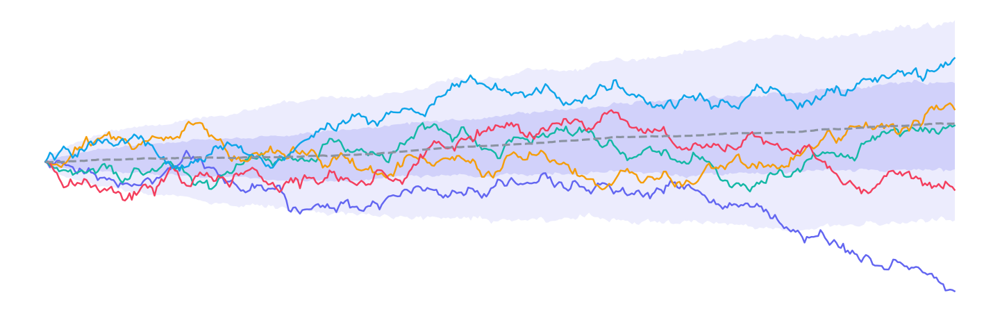
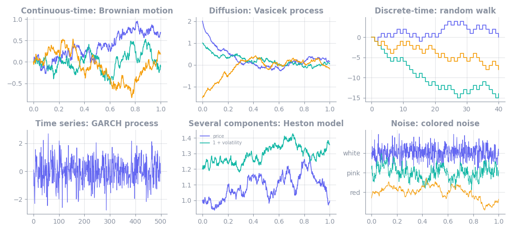

# samplepaths

[](https://github.com/samplepaths/samplepaths/actions/workflows/tests.yml)
[](https://samplepaths.readthedocs.io/)
[](https://pypi.org/project/samplepaths/)
[](https://pypi.org/project/samplepaths/)
[](https://pypistats.org/packages/samplepaths)
[](https://pepy.tech/projects/samplepaths)
[](https://github.com/samplepaths/samplepaths/blob/master/LICENSE)

Generate realizations (sample paths) of stochastic processes as NumPy arrays.



```python
from samplepaths import BrownianMotion

bm = BrownianMotion(drift=1, scale=2, t=10)
path = bm.sample(1000)  # 1001 values on [0, 10]
paths = bm.sample_paths(1000, paths=5000)  # 5000 realizations at once
```

- **37 processes** in four families: continuous-time, diffusion, discrete-time and noise
- **One interface**: every process is a class with `sample(n)` and `sample_paths(n, paths)` methods
- **Fast**: vectorized with NumPy; 1000 Vasicek realizations of 256 steps take about 2 ms
- **Reproducible**: built on `numpy.random.Generator`, per process or through a seedable default
- **Typed**: type hints throughout, checked with mypy in strict mode
- **Light**: depends only on NumPy and SciPy

Full documentation: **https://samplepaths.readthedocs.io/**

## Installation

```shell
pip install samplepaths
```

`samplepaths` requires Python 3.11 or newer, NumPy 2.2 or newer and SciPy 1.15 or newer.

## Quickstart

Create a process with its parameters, then call `sample(n)` to generate a realization of `n` increments.
For a process on a time interval, the realization holds `n + 1` values and `times` holds the matching time values.

```python
import matplotlib.pyplot as plt
from samplepaths import FractionalBrownianMotion

fbm = FractionalBrownianMotion(hurst=0.7, t=5)

for _ in range(3):
    path = fbm.sample(512)
    plt.plot(fbm.times, path)

plt.show()
```

### Reproducible results

Give a process its own generator, or seed the generator shared by all processes created without one.

```python
import numpy as np
from samplepaths import BrownianMotion
from samplepaths import random

bm = BrownianMotion(rng=np.random.default_rng(42))

random.seed(value=42)
```

### Sampling at chosen times

Most continuous-time processes can be sampled at times of your choice with `sample_at()`.

```python
from samplepaths import BrownianMotion

bm = BrownianMotion(drift=1, scale=1)
values = bm.sample_at([0, 3, 10, 11, 11.2, 20])
```

### More than one way to sample

`sample(n)` has the same signature on every process. Variants have their own methods.

```python
from samplepaths import FractionalGaussianNoise
from samplepaths import GeometricBrownianMotion
from samplepaths import PoissonProcess

prices = GeometricBrownianMotion(drift=0.05, volatility=0.2).sample_with_initial(252, initial=100.0)
arrivals = PoissonProcess(rate=2.0).sample_with_length(10.0)
noise = FractionalGaussianNoise(hurst=0.6).sample_hosking(32)
```

### Many realizations at once

`sample_paths(n, paths)` returns a two-dimensional array with one realization per row.
For most processes it is 2 to 13 times faster than a loop over `sample()`.

```python
import numpy as np
from samplepaths import GeometricBrownianMotion

gbm = GeometricBrownianMotion(drift=0.05, volatility=0.2, rng=np.random.default_rng(1))
prices = gbm.sample_paths_with_initial(n=64, paths=100_000, initial=100.0)

payoffs = np.maximum(prices[:, -1] - 105.0, 0.0)
print(np.exp(-0.05) * payoffs.mean())  # a European call price, close to 8.02
```

### Generic simulation code

Because the interface is shared, simulation code does not depend on the process it simulates.

```python
import numpy as np
from samplepaths import CoxIngersollRossProcess
from samplepaths import GeometricBrownianMotion
from samplepaths.base import BaseTimeProcess


def final_values(process: BaseTimeProcess, n: int, paths: int) -> np.ndarray:
    """Simulate a number of paths and collect the last value of each."""
    return process.sample_paths(n, paths)[:, -1]


final_values(GeometricBrownianMotion(drift=0.05, volatility=0.2), n=64, paths=1000)
final_values(CoxIngersollRossProcess(speed=1, mean=1, vol=0.5), n=64, paths=1000)
```

## Processes



Every process can be imported from `samplepaths` or from the subpackage of its family.

| Family | Subpackage | Processes |
| --- | --- | --- |
| Continuous-time | `samplepaths.continuous` | `BesselProcess`, `BrownianBridge`, `BrownianExcursion`, `BrownianMeander`, `BrownianMotion`, `CauchyProcess`, `FractionalBrownianMotion`, `GammaProcess`, `GeometricBrownianMotion`, `InverseGaussianProcess`, `MixedPoissonProcess`, `MultifractionalBrownianMotion`, `PoissonProcess`, `SquaredBesselProcess`, `VarianceGammaProcess`, `WienerProcess` |
| Diffusion | `samplepaths.diffusion` | `DiffusionProcess`, `ConstantElasticityVarianceProcess`, `CoxIngersollRossProcess`, `ExtendedVasicekProcess`, `OrnsteinUhlenbeckProcess`, `VasicekProcess` |
| Discrete-time | `samplepaths.discrete` | `BernoulliProcess`, `ChineseRestaurantProcess`, `DirichletProcess`, `MarkovChain`, `MoranProcess`, `RandomWalk` |
| Noise | `samplepaths.noise` | `GaussianNoise`, `FractionalGaussianNoise`, `ColoredNoise`, `VioletNoise`, `BlueNoise`, `WhiteNoise`, `PinkNoise`, `RedNoise`, `BrownianNoise` |

Diffusion processes are approximated with the Euler-Maruyama method.

## Documentation

The documentation at https://samplepaths.readthedocs.io/ contains:

- a [quickstart](https://samplepaths.readthedocs.io/en/latest/getting-started/quickstart.html)
- a user guide for [sampling](https://samplepaths.readthedocs.io/en/latest/guide/usage.html), [simulating many realizations](https://samplepaths.readthedocs.io/en/latest/guide/paths.html), [random number generation](https://samplepaths.readthedocs.io/en/latest/guide/random.html) and every family of processes
- a [gallery of examples](https://samplepaths.readthedocs.io/en/latest/gallery/index.html) with their figures
- measured [sampling times](https://samplepaths.readthedocs.io/en/latest/guide/performance.html) and a [changelog](https://samplepaths.readthedocs.io/en/latest/project/changelog.html)
- an [API reference](https://samplepaths.readthedocs.io/en/latest/reference/index.html) for every class, method and function

## Coming from stochastic

`samplepaths` is an independently maintained fork of [stochastic](https://github.com/crflynn/stochastic) 0.7.0 by Christopher Flynn.
It keeps the original processes and algorithms and modernizes everything around them: current Python, NumPy and SciPy, type hints, one sampling interface, and corrected drift handling.

Porting is mostly a change of import:

```python
# stochastic
from stochastic.processes.continuous import BrownianMotion

# samplepaths
from samplepaths.continuous import BrownianMotion
```

See the [migration guide](https://samplepaths.readthedocs.io/en/latest/project/migration.html) for the full list of changes.

## Development

The project is managed with [uv](https://docs.astral.sh/uv/) and `make`.

```shell
git clone https://github.com/samplepaths/samplepaths.git
cd samplepaths
make install  # create the environment
make check    # lint, type check, test and build the docs
```

Run `make` to list all targets. Bug reports and pull requests are welcome on [GitHub](https://github.com/samplepaths/samplepaths/issues); see [CONTRIBUTING.md](https://github.com/samplepaths/samplepaths/blob/master/CONTRIBUTING.md).

## License

`samplepaths` is released under the [MIT license](https://github.com/samplepaths/samplepaths/blob/master/LICENSE).

It is maintained by [Bassem Girgis](https://girgis.me).
